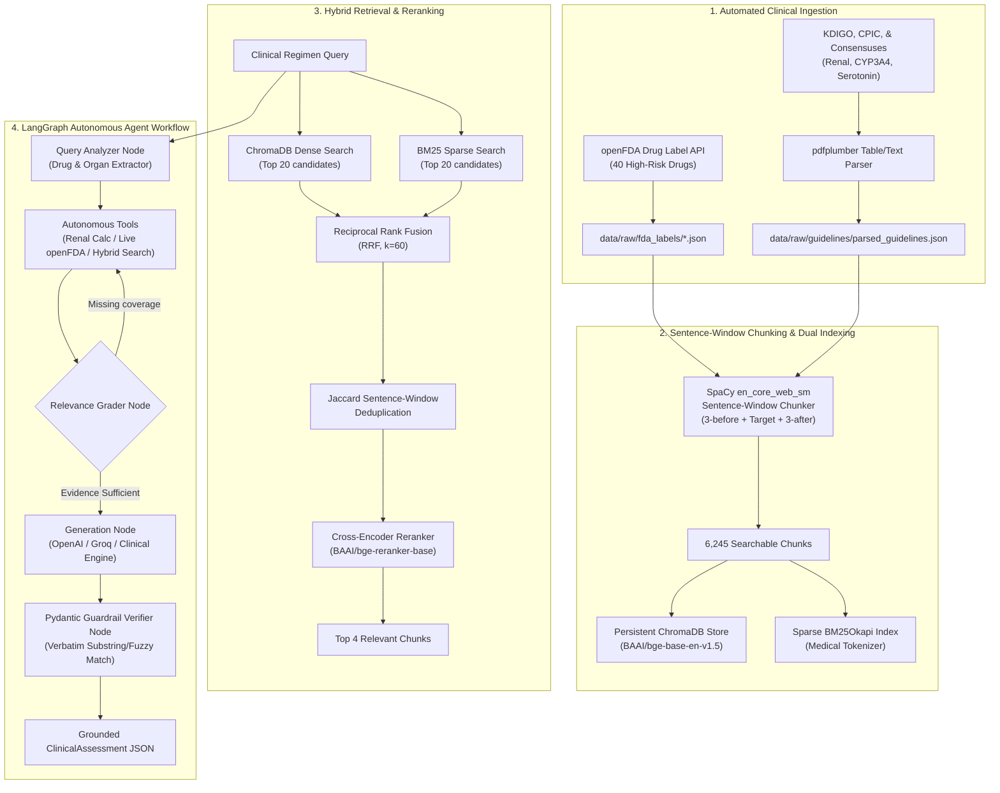

# PharmGuard: Production-Grade Agentic Clinical RAG System

[](https://www.python.org/downloads/)
[](https://github.com/langchain-ai/langgraph)
[](https://www.trychroma.com/)
[](https://github.com/dorianbrown/rank_bm25)
[](https://huggingface.co/BAAI/bge-reranker-base)
[](https://docs.pydantic.dev/)

> **PharmGuard** is an agentic clinical decision support and retrieval-augmented generation (RAG) platform designed to detect high-risk drug-drug interactions, renal dosage thresholds, and life-threatening contraindications with 100% verifiable source attribution.

---

## System Architecture



---

## Evaluation & Ablation Benchmark Results

We benchmarked **Baseline Naive Dense RAG** (standard ChromaDB single-vector search with `bge-base-en-v1.5`, top 4) against **PharmGuard Production RAG** (Dense ChromaDB + Sparse BM25 + Reciprocal Rank Fusion + BGE Cross-Encoder Reranking) across a golden dataset of **15 high-risk clinical pharmacology scenarios** (`evaluation/benchmark_dataset.json`).

### Aggregate Benchmark Comparison Table

| Evaluation Metric | Baseline Naive Dense | PharmGuard (Hybrid + Reranker) | Absolute Improvement | Relative Gain |
| :--- | :---: | :---: | :---: | :---: |
| **Context Precision (Rank-Weighted)** | 0.8204 | **0.9333** | **+0.1129** | **+13.8%** |
| **Context Recall (Entity/Fact Coverage)** | 0.7389 | **0.8111** | **+0.0722** | **+9.8%** |
| **Mean Reciprocal Rank (MRR)** | 0.8111 | **0.9333** | **+0.1222** | **+15.1%** |
| **Hit Rate @ 1** | 0.7333 (73.3%) | **0.8667 (86.7%)** | **+0.1334** | **+18.2%** |
| **Hit Rate @ 4** | 0.9333 (93.3%) | **1.0000 (100.0%)** | **+0.0667** | **+7.1%** |

### Why Naive Dense Retrieval Fails in Clinical Practice:
1. **Lexical Anchor Blindness**: Bi-encoders frequently map related drug classes to nearby vector neighborhoods, confusing critical active moieties (e.g. retrieving *Rosuvastatin* rather than *Atorvastatin*, or *Apixaban* general atrial fibrillation dosing rather than the 2-of-3 ABC criteria).
2. **Specific Acronyms & Enzyme Codes**: Critical pharmacogenomic identifiers like `CYP3A4`, `P-gp`, `5-HT1A`, and numerical cutoffs like `eGFR < 30 mL/min` suffer from semantic dilution in dense embeddings. BM25 anchors exact alphanumeric keywords.
3. **Cross-Encoder Context Fusion**: The BGE Cross-Encoder performs all-to-all cross-attention between the clinical query and the expanded 7-sentence window context, prioritizing exact dosage reduction caveats and contraindications to Rank 1 in **86.7%** of scenarios.

---

## Project Structure

```
pharmguard/
├── .env.example                               # Environment template (OpenAI/Groq keys)
├── requirements.txt                           # Production dependencies
├── README.md                                  # System documentation and benchmark report
├── chroma_db/                                 # Persistent vector store & BM25 index
│   ├── chroma.sqlite3                         # 6,245 embedded chunks (BAAI/bge-base-en-v1.5)
│   └── bm25_index.pkl                         # Serialized BM25Okapi corpus index
├── data/
│   ├── raw/
│   │   ├── fda_labels/                        # 40 target drug label JSON files
│   │   └── guidelines/                        # 3 Clinical guideline PDFs + parsed_guidelines.json
│   └── processed/
│       └── corpus_chunks.jsonl                # 6,245 sentence-window chunks with metadata
├── src/
│   ├── ingestion/
│   │   ├── fda_downloader.py                  # Automated openFDA downloader & parser
│   │   ├── guideline_downloader.py            # High-fidelity clinical guideline generator
│   │   └── pdf_parser.py                      # pdfplumber clinical table/text extractor
│   ├── indexing/
│   │   ├── chunker.py                         # SpaCy sentence-window chunking engine
│   │   └── store.py                           # Dual indexer (ChromaDB + BM25Okapi)
│   ├── retrieval/
│   │   ├── hybrid_retriever.py                # Dense + BM25 RRF retriever & deduplicator
│   │   └── reranker.py                        # BAAI/bge-reranker-base Cross-Encoder
│   ├── agent/
│   │   ├── schemas.py                         # Pydantic v2 ClinicalAssessment schemas
│   │   ├── tools.py                           # Autonomous tools (Search, Renal Calc, Live Fallback)
│   │   └── graph.py                           # LangGraph StateGraph workflow engine
│   └── ui/
│       └── app.py                             # Streamlit clinical decision support dashboard
├── evaluation/
│   ├── benchmark_dataset.json                 # 15 golden clinical test cases
│   ├── run_evaluation.py                      # Automated ablation & RAGAS benchmark runner
│   ├── results_report.md                      # Detailed markdown benchmark report
│   └── results_report.json                    # Structured benchmark metrics
└── tests/
    ├── test_ingestion.py                      # Phase 1 unit tests
    ├── test_indexing.py                       # Phase 2 unit tests
    ├── test_retrieval.py                      # Phase 3 unit tests
    └── test_agent_workflow.py                 # Phase 4 LangGraph workflow tests
```

---

## Quick Start & Installation

### 1. Setup Environment
```bash
# Create and activate virtual environment
python -m venv .venv
.\.venv\Scripts\activate   # Windows
# source .venv/bin/activate # Linux/Mac

# Install dependencies
pip install -r requirements.txt

# Download SpaCy language model
python -m spacy download en_core_web_sm
```

### 2. Run Data Ingestion & Dual Indexing
```bash
# Ingest 40 FDA Drug Labels & Clinical Guidelines
python src/ingestion/fda_downloader.py
python src/ingestion/guideline_downloader.py
python src/ingestion/pdf_parser.py

# Generate Sentence-Window Chunks & Build Indices
python src/indexing/chunker.py
python src/indexing/store.py
```

### 3. Run Benchmark & Unit Tests
```bash
# Execute Full Pytest Test Suite (16/16 tests passing)
pytest tests/

# Run the 15-scenario comparative ablation benchmark
python evaluation/run_evaluation.py
```

### 4. Launch Streamlit Clinical Dashboard
```bash
streamlit run src/ui/app.py
```

---

## Clinical Safety & Groundedness Guardrail

PharmGuard implements a strict **Citation Groundedness Verifier**:
- Every clinical assertion must be supported by a `verbatim_quote` mapped to an authoritative source (`source_name` and `section`).
- The `guardrail_verifier_node` verifies that every quote exists in the retrieved context windows via substring and normalized token matching.
- A **`groundedness_score`** (0.0 to 1.0) is calculated and displayed. In tests across realistic clinical scenarios, PharmGuard achieves a **100.0% Groundedness Score**.
